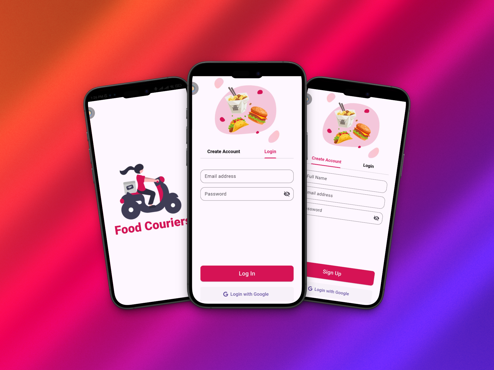
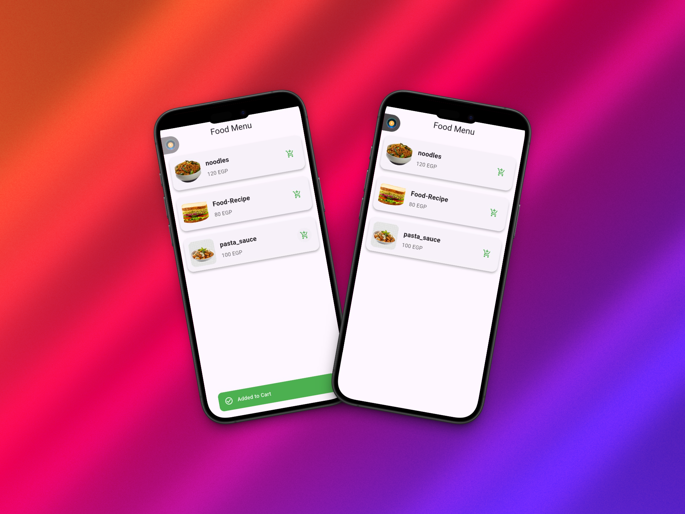

# 🍽️ Flutter Restaurant App 

A work-in-progress restaurant app built using **Flutter** and **Firebase**, developed as part of my internship at **Reco Genie**.  
This phase focused on implementing the **core functional features** and connecting the app to the cloud using Firebase services.

---

## 📹 Demo

  <video src="https://github.com/user-attachments/assets/ac08b335-655d-40f4-9fca-680d8db6c42d" controls width="480" style="border-radius: 12px;"></video>

---

## 📸 Screenshots

<table>
  <tr>
    <td></td>
    <td></td>
  </tr>
  <tr>
    <td><b>Splash Screen and Auth</b></td>
    <td><b>Onboarding</b></td>
  </tr>
</table>

 

<table>
  <tr>
    <td></td>
  </tr>
  <tr>
    <td><b>Add to Cart</b></td>
  </tr>
</table>

---

## 🚀 Features Implemented in This Phase

- ✅ **Splash Screen**  
  Smooth intro screen while app initializes.

- ✅ **Onboarding Flow**  
  Walks users through the app's features on first launch.

- ✅ **Firebase Authentication**  
  - Sign Up / Sign In using email and password  
  - Integrated securely using Firebase Auth

- ✅ **Displaying Food Items**  
  - Real-time data fetched from **Cloud Firestore**  
  - Showcases dynamic food listings

- ✅ **Cart Functionality**  
  - Add/remove items to cart  
  - Cart state is managed efficiently and synced in real-time

---

## 🔧 Tech Stack

- **Flutter** for cross-platform UI
- **Firebase Authentication** for user login/register
- **Cloud Firestore** for real-time database
- **Firebase Core** for project integration and cloud support

---

## 📌 Project Status

> This project is **still in progress** – more features (like order checkout, user profiles, and payment integration) will be added in the upcoming phases.

---

## 🤝 Credits

Developed during my internship at **Reco Genie**
